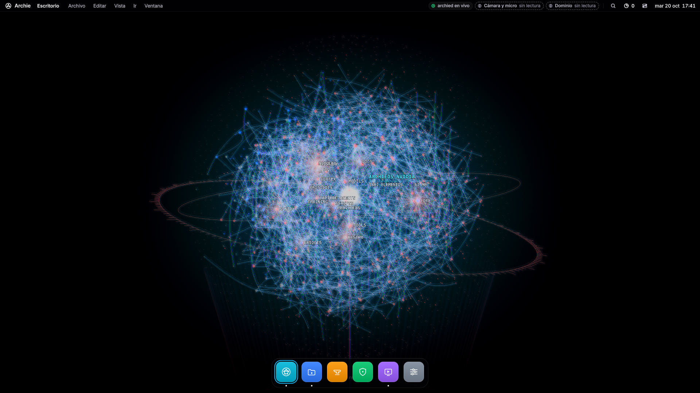
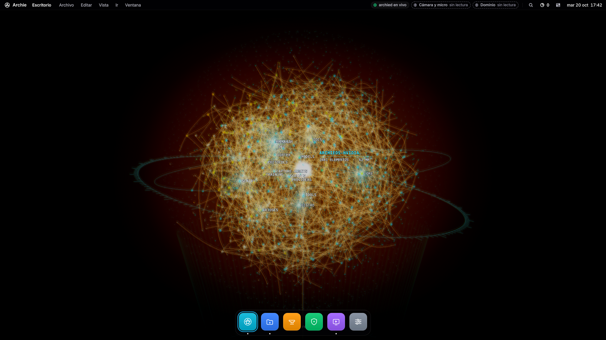
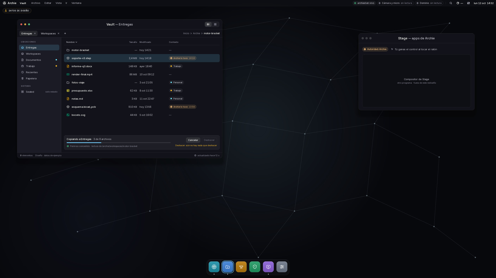
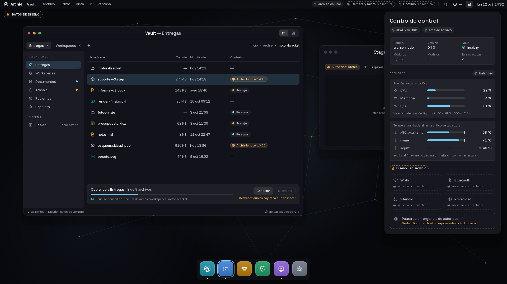
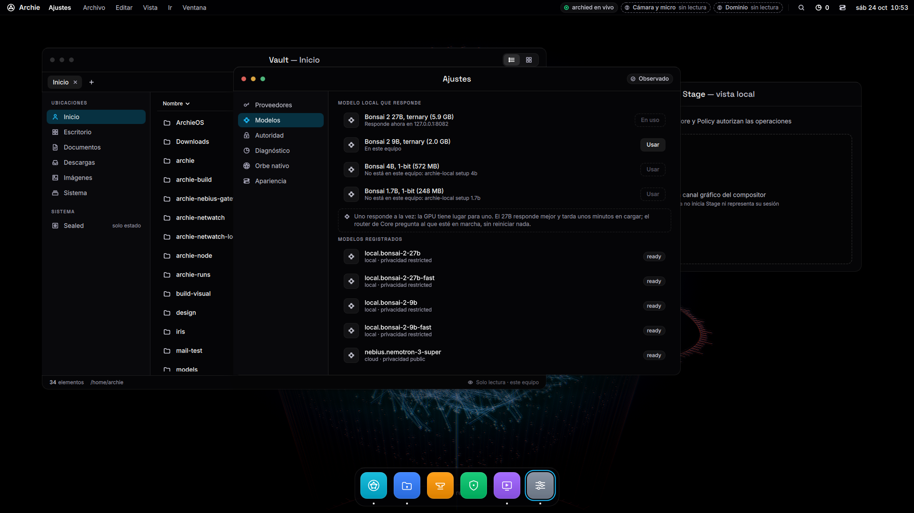
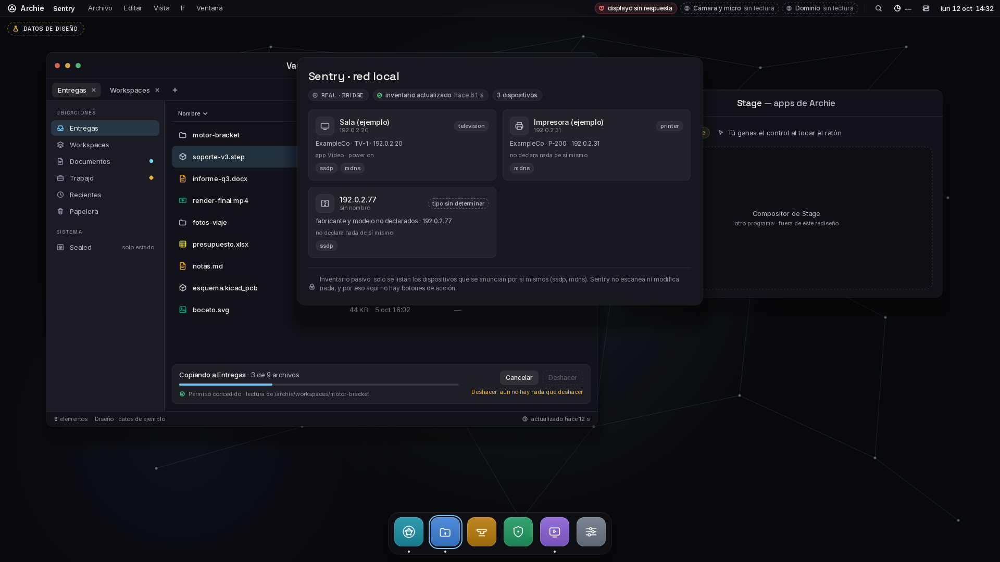

<div align="center">



# ArchieOS · NVIDIA Edition

### Talk to your computer. It answers, sees, acts, and asks permission first.

**A personal AI that lives in the operating system, not in a browser tab.**
Voice in, voice out. Eyes on the screen and the camera. Hands on real applications.
Every action sealed, leased, policy-checked, and returned as a receipt.

[](LICENSE)


[Why it is different](#why-it-is-different) ·
[See it](#see-it) ·
[How it works](#how-it-works) ·
[What works today](#what-works-today) ·
[Run it](#run-it) ·
[Status](#status) ·
[Credits](#credits)

</div>

---

## The idea in one line

> **Models propose, Cerebra decides, Policy authorises, the Stage executes.**

Most assistants are a model with tools bolted on. ArchieOS inverts that: **identity, memory,
policy and authority belong to the machine**, and language and vision models are replaceable
resources it calls. Swap Nemotron for another planner tomorrow and Archie is still Archie, with
the same memory, the same rules and the same eyes and hands.

A model never touches the computer directly. Anything it wants to do becomes a sealed, leased
command that the policy can refuse, and every result comes back as a receipt. Touch the mouse
and Archie lets go, instantly. No tool gives control back to it.

## Why it is different

| | |
|---|---|
| 🎙️ **Voice is the interface** | Speech to speech on the machine. Nemotron 3.5 streaming ASR (Spanish and 39 other language-locales), a floor manager that decides whether Archie was actually addressed, and a voice (Piper on CPU, Magpie on GPU) that answers in short sentences, in the language you used. |
| 👁️ **Real eyes** | **IRIS**, our own open-vocabulary vision model, reads the screen and the camera. Archie is told only what IRIS sees, how old it is, and what was there before. Faces are blacked out of every crop; it never identifies people. |
| 🖐️ **Real hands** | A Wayland compositor (**Archie Stage**) where Archie clicks, types, scrolls and drags in real applications, grounded by accessibility first, a local reflex model second and a vision model last. |
| 🛡️ **Authority that cannot be talked around** | HMAC-sealed, leased commands; a per-application policy; privacy as a routing *disqualifier*, not a weight; a vault whose grades are authenticated, not labelled. A password contributes nothing to reasoning, by construction. |
| 🌐 **Provider-neutral** | NVIDIA NIM, Nebius Token Factory, or any local OpenAI-compatible server. Keys are read from the environment at request time and never written to the repo or the image. |
| 🔮 **You can see it think** | The Observatory renders the live graph of the system as a sphere. Whatever Archie is using lights up. |

## See it

The shell is a native desktop for Archie: **Vault** (files with provenance: what Archie touched, and when),
**Forge** (the machine's applications and bridges), **Sentry** (a passive view of the local network),
and a control centre showing resources and authority.

<div align="center">

<sub><b>The Orb.</b> This very repository (1,881 elements, 62 MB), rendered live as a TFOG graph. Cold and warm holograms.</sub>
</div>

<br>

<table>
<tr>
<td width="50%"><br><sub><b>Vault + Stage.</b> Files marked with who touched them, and the Stage window where Archie works. The person always wins control by touching the mouse.</sub></td>
<td width="50%"><br><sub><b>Control centre.</b> Pressure, temperatures, modules, models, and the emergency authority pause.</sub></td>
</tr>
<tr>
<td width="50%"><br><sub><b>Local models.</b> Pick which model answers (one at a time on one GPU) from a live node. The router asks whichever is running; nothing restarts.</sub></td>
<td width="50%"><br><sub><b>Sentry.</b> A passive inventory: it lists only what devices announce about themselves. It does not scan and it has no action buttons.</sub></td>
</tr>
</table>

> The Vault, Control centre and Sentry captures are the design handoff with sample data
> ([`docs/gui`](docs/gui/README.md)); the sphere and the model settings come from a live node.

## How it works

```text
 microphone ─► Nemotron 3.5 ASR ─► floor ─► Nemotron (Nebius / NIM / local) ─► voice (Piper / Magpie)
                                               │ proposes
 camera ─► IRIS ─► scene + memory ─────────────┤
                                               ▼
                                 Cerebra ─► Policy ─► Stage ─► applications
                                               │
                         TFOG signals ─► archie-displayd ─► Observatory (World · Forge · Orb)
```

| Part | Role |
|---|---|
| **Planner** | Any reasoning model, local or remote. Understands the request, decides, checks the result. |
| **IRIS** | The node's own vision model, always local. Finds what a phrase names, turns one short instruction at a time into pointer and keyboard input, remembers what it saw. |
| **Speech** | The node's ears and voice, plus the **floor**: it defaults to silence and speaks only when addressed. |
| **Cerebra + Policy** | Not models. They decide whether anything happens, what may be disclosed, what is allowed. |
| **Stage** | Executes sealed, leased commands. The person's mouse always wins. |
| **Bridges** | Exact, cheap automation for applications that expose it (FreeCAD, KiCad, video). |

Read the contract every model works under in [ARCHIE.md](ARCHIE.md) and the system design in
[ARCHITECTURE.md](ARCHITECTURE.md).

## What works today

**Talking to Archie**
- `archie-voice converse`: speech to speech on the machine. Nemotron 3.5 streaming ASR through
  NVIDIA NeMo-Speech.cpp, the floor, Nemotron on Nebius for the answer, and a voice. Piper can
  use separate local Spanish (`ald`) and English (`john`) voices and switch sentence by
  sentence; they are open voices, not recordings or clones of any actor.
- `archie-voice live`: the same conversation from a browser page (microphone, speaker and camera
  over a loopback WebSocket), with **IRIS as Archie's eyes**. It can look closer at an object,
  identify it with a vision model on Nebius (Kimi K3, then MiniCPM-V 4.5), read about it, and
  keep that until asked.
- `display/stage/run-archie.sh`: one command for the Stage and the voice together.

**Acting on the machine**
- **Archie Stage** (`display/stage`): a Wayland compositor. Clicks, typing, keys, held keys
  (released after 5 s or when the operator takes over), scrolling, drags and strokes. The policy
  in `core/crates/archie-stage/policy/apps.toml` names which applications may be launched and
  what may be done in each.
- **Hands**: Nemotron proposes a tool call, it is checked strictly and carried out through the
  Stage gate.
- **Video editing** (`archie-cut`): timelines, titles, music and fades rendered by MLT
  (Kdenlive's engine), headless.
- **IDE agents** (`archie-mcp-server`): Archie's tools over MCP.

**Seeing**
- **IRIS** ([`PentaVM/archie-iris`](https://github.com/PentaVM/archie-iris)): open-vocabulary
  detection. An image and phrases in; boxes, points, a score and an identity embedding out.
  Beta 1.1 (754 M parameters, V-JEPA 2.1 + SigLIP2 + sparse MoE) measured at 159–217 ms per
  image on an RTX 3090. Beta 2 is training.
- `archie-iris-bridge`: turns an IRIS proposal into a Stage request that Cerebra and the policy
  still have to admit.

**Showing what happens: the Observatory** (`display/native`, Qt Quick 3D)
- **World**: the Earth, lit by the real sun, with real observations.
- **Forge**: the machine's applications as a desktop.
- **Orb**: the live TFOG graph of the system. See [`docs/TFOG-ORB-RENDERING.md`](docs/TFOG-ORB-RENDERING.md).

**Underneath**
- Rust authority, policy, scheduler, model router, memory and PostgreSQL/TimescaleDB state;
  Cerebra; the Vault; Cortex and Sentry in C++; OSM building ingestion; ArchISO and WSL2 packaging.
- Rust for the control plane, C++ for the native and visual subsystems. The optional Piper bridge
  is the only Python on the voice path.

## Run it

Build the Rust workspace (Rust 1.88+):

```bash
cd core
cargo build --release -p archie-voice --features speech   # converse
cargo build --release -p archie-voice --features live     # live, with the browser page
cargo test --workspace --locked
```

`speech` and `live` need NeMo-Speech.cpp (`NEMO_SPEECH_PREFIX`) and PulseAudio;
`scripts/models/install-nemotron-speech.sh` fetches the pinned ASR model. Piper voices:
`scripts/models/install-piper-runtime.sh` and `scripts/models/install-piper-voices.sh`.

Talk to Archie, with the Stage:

```bash
NEBIUS_TOKEN_FACTORY_KEY=... display/stage/run-archie.sh public
```

A live session with eyes (IRIS served by `archie-iris` on the GPU host):

```bash
archie-voice live --grade public --asr-model <nemotron-3.5-asr.gguf> \
  --voice-engine magpie --tts-model <magpie.gguf> --codec-model <nanocodec.gguf> \
  --tts-tokenizer <dir> --iris http://127.0.0.1:8765
```

The page listens on loopback (`--port`, default 8770); reach it through an SSH tunnel.

The Observatory (Qt 6.6+ with Quick 3D) and its data daemon:

```bash
cmake -S display/native -B build/display -G Ninja && cmake --build build/display
core/target/release/archie-displayd &
build/display/archie-display --scene orb      # or world, forge
```

`scripts/check.sh` runs the checks worth running before a push.

### On Windows: ArchieOS Workstation for WSL2

An Arch Linux WSL2 distribution with systemd, a non-root `archie` session, a sealed Vault, local
Nemotron ASR, provider adapters and FreeCAD, plus a Windows **launcher** (`distro/windows`) that
starts the node, opens the GUI and the voice, and lets you pick the local model.

```powershell
sudo ./scripts/wsl/build-rootfs.sh ./dist
wsl --install --from-file .\dist\ArchieOS.wsl
```

See [WSL build](docs/WSL-BUILD.md), [first run](docs/FIRST-RUN.md) and
[security boundary](docs/SECURITY-BOUNDARY.md).

## Status

**The core of ArchieOS works, end to end:** speech to speech (converse and live), the Stage and
its policy, hands through accessibility and vision, video rendering, the Observatory's three
scenes, IRIS detection behind the live session, the control plane, the WSL2 workstation and the
launcher.

- **Next up:** IRIS Beta 2 (more experts, GUI, sport and text data) is training; Cortex will drive
  the Observatory's view by command; IRIS will propose actions beyond clicks; the Quickshell/Vault
  GUI is moving from design to the native host.
- **IRIS without Python:** `archie-iris-serve` already runs Beta 2.1 and matches the Python IRIS
  on CPU ([`docs/IRIS-RUNTIME.md`](docs/IRIS-RUNTIME.md)); the CUDA build is next.
- **Experimenting:** Nemotron 3 Nano Omni as the brain that hears, with Magpie's voice.

Provenance of what was built for the hackathon and what pre-dates it is in [HACKATHON.md](HACKATHON.md).

## Read more

[ARCHITECTURE.md](ARCHITECTURE.md) · [ARCHIE.md](ARCHIE.md) · [`docs/STAGE.md`](docs/STAGE.md) ·
[`docs/SPEECH-NEMOTRON.md`](docs/SPEECH-NEMOTRON.md) · [`docs/IRIS.md`](docs/IRIS.md) ·
[`docs/VAULT.md`](docs/VAULT.md) · [`docs/SECURITY.md`](docs/SECURITY.md) ·
[`docs/gui`](docs/gui/README.md)

## Credits

- **PentaVM**: architecture, the Rust/C++ implementation, the control plane, IRIS, the voice stack
  and the native GUI.
- **Xavi** ([`ByXavi270`](https://github.com/ByXavi270) / XaviCottier): the design of the
  professional Quickshell/Vault GUI, the neural sphere and the WSL generation.
- **Santiago Rearte** (Sheriff): the Nebius Token Factory and Nemotron integration, and testing
  the node on his own WSL.
- Built on NVIDIA Nemotron, NeMo and NIM, Nebius Token Factory, Piper, MLT, Qt and Wayland.

## License

Apache License 2.0 — see [LICENSE](LICENSE) and [NOTICE](NOTICE). Apache rather than MIT for the
patent grant: this repository contains device control, physical actuation and inference-routing
work. Upstream data providers keep their own terms; `providers/` records the attribution each one
requires, and the registry refuses to display records from a provider whose attribution is missing.

<div align="center">

<br>

**Made with love ♥**

*by PentaVM, Xavi and Sheriff*

</div>
