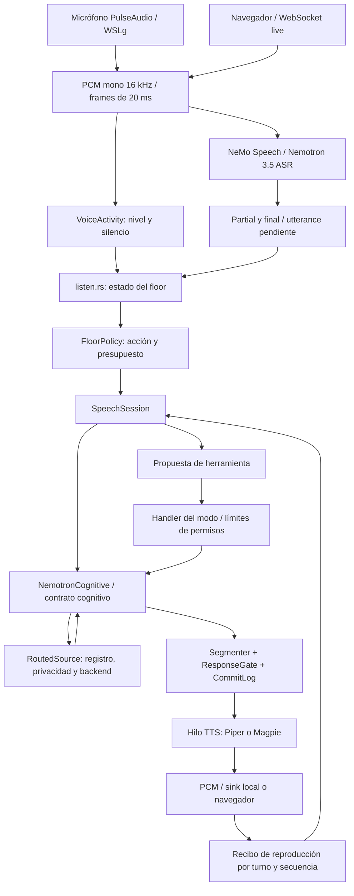

# Arquitectura actual del floor y la voz

Lectura de código de PentaVM/ArchieOS-Nvidia, main `bca8473`, 21 de octubre de 2026. No se ejecutaron micrófono, modelos, síntesis ni benchmarks. Wanda/LNCM queda fuera de esta revisión, a cargo de Claude. La supervisión automática de Wanda de este chat fue retirada por instrucción del propietario.

## Ruta de conversación que existe

`live` y `converse` comparten `conversation::converse`. Cambian captura, reproducción y contexto/herramientas; no son dos motores de floor independientes. `archie-talk` lanza `run-archie.sh`, que usa `converse` y Piper bilingüe. `archie-offline` tiene otro launcher: comprobar sus flags/entorno al comparar una instalación concreta.

## Floor: estado, decisión y ejecución

1. `audio.rs` estima actividad por nivel relativo al ruido y acumula silencio. No es diarización ni un modelo de intención.
2. `listen.rs` construye el estado: nombre de Archie, ventana de continuación, acknowledgements, final del ASR, puntuación y conectores como «pero»/«y». La ventana base de continuación es 10 s.
3. El loop conserva cláusulas incompletas y reúne finales ASR, hasta 16 KiB. Un final ASR no inventa tiempo de silencio. La lectura ASR se alimenta con bloques de aproximadamente 160 ms.
4. `FloorPolicy` decide `Silent`, `Backchannel`, `ShortResponse`, `Yield`, `SoftInterrupt`, `StrongInterrupt`, `TakeFloor` o `ContinueSpeaking`. Produce un presupuesto `None`, `Token`, `Sentence` o `Full`.
5. `SpeechSession` inicia cognición solo con presupuesto de frase/respuesta. El contrato distingue texto generado, liberado y reproducido; las propuestas no son permisos.

Umbrales predeterminados de la política de voz: hold 0,5; utilidad de respuesta 0,35; interrupción suave 0,7; fuerte 0,85 con urgencia 0,8; acknowledgement 0,7; contexto 0,4. Son parámetros del código, no probabilidades calibradas empíricamente. El estado vivo asigna varias puntuaciones mediante reglas.

Hay tiempos concretos pese al diseño conceptual de floor continuo: silencio mínimo de 300 ms en la clasificación de pausa; endpoint de respaldo de 800 ms por defecto; hasta 320 ms de solapamiento acústico para ceder sin palabras suficientes; backchannel previsto en la política a 1.500 ms de pausa durante un hold. La sesión no inicia un LLM por un backchannel, y el loop no presenta aquí una ruta completa de backchannels espontáneos durante el habla del usuario.

## Dos contratos de floor que todavía deben reconciliarse

| Ruta | Productor/consumidor | Diferencia |
|---|---|---|
| Voz en vivo | `listen.rs` → `archie-speech::FloorPolicy` → `SpeechSession` | Estado con Speaker, SilenceScope, evidencia y presupuesto de voz; incluye Yield. |
| Pase de Cerebra | `Observation.floor` → `archie-memory::floor::decide_floor` | Otro estado con timestamp y referencias; rechaza observaciones de más de 2 s; `can_speak` y alerta crítica son entradas confiables. |
| Estimador acústico | `archie-speech::estimator::FloorEstimator` | Cinco cabezas lineales sobre cuatro características: bias, amplitud, silencio y cruces por cero. Produce el estado de archie-memory, no el de FloorPolicy de voz. |

El estimador es una baseline local con aprendizaje supervisado y parámetros persistibles de siete días. No existe aquí evidencia de un modelo entrenado/calibrado de turn-taking. La búsqueda de usos encontró persistencia en Cerebra, pero no una invocación del estimador desde el loop de voz. Tampoco ese loop recorre automáticamente el pase completo de Cerebra: usa directamente el adaptador cognitivo y un handler de herramientas suministrado por el modo.

`addressee.rs` acepta presencia de terceros, orientación, llamada y voz identificada. El camino `begin_pending` usa el wrapper con `AddresseeCues::default()`: tener estos campos no significa que cámara/identidad los estén alimentando en esa ruta.

## Generación, pronunciación e interrupción

- `NemotronCognitive` es el nombre del adaptador, no una obligación de usar ese modelo. `RoutedSource` selecciona un backend del registro y aplica la frontera de privacidad; el modelo puede ser local o remoto.
- `Segmenter` reúne tokens hasta una frase o, por encima de 110 caracteres y con separación adecuada, una cláusula. No entrega tokens sueltos al TTS.
- Piper bilingüe usa un bridge externo y voces ONNX ES/EN; Magpie tiene otra ruta nativa. La conversión RVC live está restringida a Magpie. La selección de idioma sigue siendo heurística.
- Síntesis/reproducción corren en un hilo propio. La captura, tratamiento ASR y avance del turno se coordinan desde el loop principal.
- Con auriculares, el overlap pasa por floor; Yield cancela la generación, cambia la generación atómica e invalida audio pendiente. Un acknowledgement no equivale a tomar el turno.
- Sin auriculares se evita alimentar ASR mientras Archie reproduce, porque esta ruta no integra cancelación de eco. Así no puede ofrecer interrupción natural equivalente con altavoces.
- La cancelación se comprueba al volver al callback PCM; no preempta una síntesis nativa bloqueada. El sink también puede bloquear.
- PulseAudio puede drenar/descartar su cola. El navegador usa pacing nominal, con hasta 250 ms por delante; no hay ACK real de reproducción del cliente. El commit es conservador por segmento completo: una frase interrumpida a medias no se considera íntegramente oída.

## Prioridades de mejora propuestas

1. **Un contrato común de floor, con estimadores intercambiables.** Conservar la separación entre evidencia, política y permisos; definir cómo se traduce al pase de Cerebra y cómo se ejecuta Yield. Evitar dos decisiones incompatibles sobre el mismo turno.
2. **Full duplex real y eco.** Incorporar la referencia del audio reproducido y verificar AEC en hardware antes de abrir siempre el micrófono durante reproducción con altavoces.
3. **Quitar trabajo lento del loop de captura.** `rehear.recognize` y `act` se ejecutan sincrónicamente desde el loop. Separar captura/ASR, herramientas y reconocimiento de segunda pasada, con colas acotadas, cancelación y resultados ligados al turno.
4. **Endpoint adaptativo y destinatario con evidencia real.** Conectar características acústicas/prosódicas y contexto de sesión, preservando silencio conservador cuando falten señales. Calibrar con replays; no sustituir las reglas por un LLM en cada frame sin medir coste/latencia.
5. **Recibos y telemetría por toda la cadena.** Marcar captura, partial/final ASR, decisión de floor, request/primer token, segmento, primer PCM y reproducción/ACK; medir cancelación hasta último audio. Separar generado, enviado, reproducido y reconocido por el cliente.
6. **Streaming TTS y presión de colas.** Medir espera introducida por segmentación, duración de audio pendiente y capacidad efectiva de cancelación de cada backend antes de cambiar voces/modelos.

La telemetría actual incluye `Heard`, `Floor` con razones/evidencia, `Speaking`, `Said` con primer audio/duración/stopped, `Proposed`, `Did`, `Interrupted`, `Alert`, `Level` y `Ready`. No constituye todavía una medición uniforme extremo a extremo ni demuestra latencia audible.

## Mapa de código

- `core/crates/archie-voice/src/conversation.rs`: loop, colas, cancelación, recibos.
- `core/crates/archie-voice/src/listen.rs`, `addressee.rs`, `audio.rs`: estimaciones heurísticas y audio.
- `core/crates/archie-speech/src/floor.rs`, `session.rs`, `cognitive.rs`: política, sesión y commit.
- `core/crates/archie-memory/src/floor.rs`, `core/crates/archie-cerebra/src/pass.rs`: floor del pase cognitivo.
- `core/crates/archie-speech/src/estimator.rs`: baseline acústica local.
- `core/crates/archie-voice/src/nemotron.rs`, `segment.rs`, `piper.rs`, `voice.rs`: generación y pronunciación.
- `core/crates/archie-voice/src/bin/archie-voice.rs`, `live/mod.rs`: ensamblaje de modos.

Esta propuesta no modifica Wanda/LNCM, Core, Cortex, Policy, leases ni los dominios. Se necesita medición real para asignar presupuestos de latencia o afirmar mejoras.
