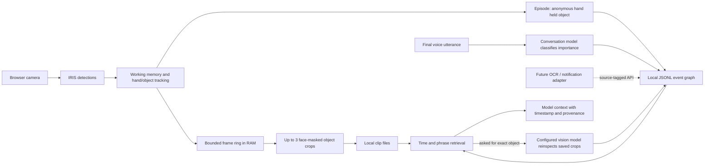

# RFC-013 — Persistent personal memory

- **Status:** first local implementation
- **Scope:** time-stamped personal events from live voice and IRIS vision, bounded retention,
  and reinspection of recent visual evidence
- **Storage:** local to one Archie node; no network sync

## Data path



## Current live path

```mermaid
sequenceDiagram
  participant B as Browser
  participant L as Live voice service
  participant I as IRIS
  participant W as Working memory
  participant P as Persistent memory
  participant N as Conversation / vision model
  B->>L: camera JPEG
  L->>I: detect objects, hands and boxes
  I-->>L: labels, scores, boxes, embeddings
  L->>W: update current scene
  W->>W: hand/object overlap for 2 frames
  W-->>L: held event with frame timestamp
  L->>L: sample at most 4 scenes / 8 MiB RAM
  L->>P: event + up to 3 cropped frames
  P->>P: append event; compact hourly and on startup
  N->>P: time-bounded memory context for the utterance
  P-->>N: timestamp, source, category and evidence availability
  N->>P: optional identify request when current camera is stale
  P-->>N: saved crops; vision result is stored as a hypothesis
```

## Event and retention model

An event is a compact graph edge plus source, event time, confidence, repetition count,
retention tier and optional evidence references. The current producers are final voice
utterances and hand/object episodes from the live IRIS scene. Text adapters can call the
same source-tagged `captured_text` entry point.

| Tier | Retention | Payload |
|---|---:|---|
| T4 | up to 1 day; one-off wants expire after 3 days | exact event and recent visual crops |
| T3 | up to 7 days | event and source |
| T2 | up to 30 days | compact event and source; image crops are deleted |
| T1 | persistent until removal or the hard event quota | attributed statement or durable fact; images are deleted |

The conversation model can classify a heard item through `remember`. A small local phrase
rule also recognizes common durable statements such as a reported death, so one important
utterance can survive even if the model does not call the tool. One-off wants such as
“quiero comer lasagna” remain short-lived. These rules mark what was said; they do not
verify it. `remember` can only reclassify the exact text of an utterance recorded in the
previous five minutes; it cannot create a user-attributed statement on its own. Persistent
facts retain the speaker attribution.

At the moment, retention runs on startup and at most hourly. Storage is bounded at 10,000
events, 128 MiB of evidence crops, 2 MiB per crop, 8 MiB for the in-memory frame window,
and 6,000 bytes of recalled context. On Unix the memory directory is mode 0700 and files
are mode 0600. `ARCHIE_MEMORY_DIR` can override the default local state path.

## Evidence and limits

IRIS currently produces general categories and an anonymous hand/object overlap. The
memory therefore says “IRIS saw a hand holding a cell phone”; it cannot establish whose
hand it was. A later `identify` request may run the saved crops through the configured
vision model and stores its product name as a hypothesis, for example “possibly a Xiaomi
14T”. The stored evidence is a short set of cropped stills, not continuous video. Faces
and eyes inside those crops are blacked out when IRIS detected them; full frames and object
embeddings are never persisted.

The live voice path is wired. The OCR/WhatsApp body path is not: current capture agents
provide notification metadata and do not forward message bodies. An adapter must make an
explicit local decision to pass text to `captured_text`; this RFC does not change those
capture permissions. Durable data is local-only and currently relies on filesystem
permissions rather than application-level encryption.
