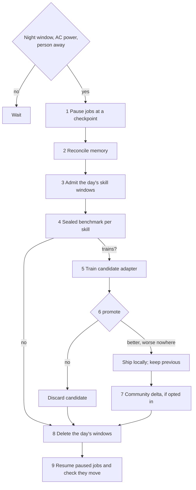

# RFC-014 — REM sleep: nightly reconciliation and skill learning

- **Status:** partly built.
  - archie-iris serves and trains skills (`/act?adapter=`, `skill_training`, `promote()`) and
    prepares a night's training from verified windows (`rem_sleep`).
  - `archie-rem` is the supervisor: the gate, pausing and resuming registered jobs, the
    activity file the trainer reads, the day's encrypted buffer and its deletion, and
    recovery of a cycle cut short. See [What is built](#what-is-built).
  - Nothing records windows yet, so a cycle has nothing to train on. Steps 2 and 7 are design.
- **Scope:** what Archie does while the person sleeps: reconcile memory, benchmark its
  skills in secret, train the ones that need it, promote or discard, then resume paused work.
- **Runs on:** the person's machine. The smallest supported GPU is an RTX 3060 Ti (8 GB).
- **Depends on:**
  - [RFC-009](RFC-009-ANALYTICAL-CORTEX.md) consolidation;
  - [RFC-011](RFC-011-LEARNING-ADMISSION.md) admission;
  - [RFC-013](RFC-013-PERSISTENT-PERSONAL-MEMORY.md) memory tiers;
  - [IRIS privacy](IRIS-PRIVACY.md) retention decision.

## Why

Archie learns a program or a game as a **skill**, a small LoRA adapter on the frozen IRIS
base. Skills are:

- **swappable per call:** one call can use Kdenlive and the next CS:GO;
- **downloadable** when Archie sees new software;
- **improvable by the community** without anyone sending frames.

Training competes with the person for the GPU. So on the person's machine it happens in only
one place: REM, the nightly cycle that also tidies Archie's memory.

## The cycle

The REM supervisor is a Rust service. It launches the trainer as a separate process. The
trainer is the IRIS Foundry trainer, the one place Python is allowed.

### 0. Entering and leaving

REM starts only when all of these hold:
- it is inside the night window (default 02:00–06:00 local time; configurable);
- the machine is on mains power;
- nobody has touched it for 30 minutes.

When the person comes back, REM stops within one training step:
- the candidate is kept on disk only until the end of this cycle;
- paused jobs are resumed;
- the day's windows are still deleted (step 8).

Retention is never extended by an interrupted night.

### 1. Pause

Every long job registers:
- a checkpoint command;
- a resume command;
- a liveness probe, such as a heartbeat file and its maximum age.

REM checkpoints and pauses each job and writes the resume list to disk *before* starting
anything else. The resume list lives on disk, in the supervisor, not in a chat session. A
supervisor that crashes finds the list at start-up and resumes from it.

### 2. Reconcile memory

These already exist and currently run on start-up or hourly; REM runs them in one quiet pass:
- RFC-013 tier demotion and retention (T4 → T3 → T2 → T1, evidence crops deleted on schedule);
- RFC-009 consolidation proposals;
- RFC-011 admission decisions and expiry of the day's hypotheses.

This step also compacts the action head's T1–T3 context for each active skill. Its outputs
are:
- the list of skills that were used today;
- how many windows each skill has.

### 3. Admit the day's skill windows

Recording is opt-in. Only a person who opted in has windows recorded, and they are stored
encrypted in Vault.

A window is what the action head sees for one decision:
- the current frame;
- 2 recent frames;
- 4 compacted frames;
- the last 4 inputs;
- the skill's durable context;
- the input that was actually given.

It is stored in the `archie-iris-act-window-v1` format.

Nothing is recorded from:
- apps on the exclusion list (banking, password managers, messaging);
- password fields;
- visible faces, which are blacked out.

Admission follows RFC-011 rule 4: model-generated labels cannot supervise the same model. A
window may train a skill only if its label is one of these:
- **a person's demonstration:** the person was driving the app, and the input is theirs;
- **a verified outcome:** Archie drove the app and the task's judge or the person confirmed
  success. The window carries the verification receipt.

Archie's own unverified actions are never labels. That also means a skill learns from what
worked, not from the average of what happened.

### 4. Sealed benchmark

Each skill has a benchmark that the person never sees and the trainer never trains on.

**On the device**, the sealed set is:
- one window in five, chosen by a keyed hash (`IRIS_SKILL_SEAL`, held in Vault and not
  readable by the trainer);
- plus any sealed windows that came with the skill's package.

On the device, "sealed" means hidden from the interface and from the trainer. It is not
hidden from someone with root on their own machine. The community gate (step 7) is the one
that is truly sealed.

**Train or not.** The benchmark decides whether a skill trains tonight. It trains only if
all of these hold:
- there are at least 64 admitted training windows since its last attempt;
- its last three attempts were not all rejected as `no_gain` (a plateau), unless the base or
  the package changed since;
- REM time is left.

Skills are trained in order of use today.

### 5. Train

Training uses `python -m archie_iris_foundry.skill_training`:
- The base stays frozen. Only the skill's rank-8 adapter pairs train: the action head's
  memory and output layers, and the last fusion layer.
- Gradients stop at that fusion layer. Memory frames are encoded without gradients.
- Batch 4, bf16, 300 steps by default, with a time budget per skill.

The job reports `peak_gpu_gb`. The 8 GB fit on a 3060 Ti has **not been measured yet**. The
first measurement on the Beta 2 base is an open item; if it does not fit, the batch shrinks
before anything else changes.

### 6. Promote

`promote(before, after)` compares:
- **before:** the package in use, or the plain base;
- **after:** the candidate.

Both are measured on the same sealed windows. The candidate is promoted only if the summed
gain beats the margin (0.01) and no measure falls by more than the margin. Measures include:
- key F1;
- mouse within one bin;
- pointer within 5 %;
- step-type accuracy.

A promoted package replaces the old one atomically, and the previous package is kept for
rollback. It then goes through **probation**, which is RFC-011's shadow step. For its next
tasks with verification receipts, the success rate is compared with the previous package's
rate. A drop rolls it back and reports it.

A package is bound to its base fingerprint. The fingerprint is computed at bf16 precision,
so GPU and CPU serving agree. When a new base arrives, old packages are refused, not
misapplied.

### 7. Community learning (a second, separate opt-in)

What leaves the machine:
- only the adapter's weight change (B·A before and after);
- clipped and noised for differential privacy;
- signed by the node.

Never frames, text, windows or benchmark results.

The cloud:
- aggregates with a robust rule (trimmed mean), so a few poisoned deltas cannot steer it;
- runs its own sealed benchmark per skill, which no client ever sees;
- publishes a new signed package for the base only when that benchmark promotes it.

Clients install packages:
- when Archie first sees the software (by executable, window class or a Bridge);
- or when a newer package for their base exists.

A downloaded package still passes the local sealed benchmark before it replaces a
locally-trained one.

**Games.** A skill improves play against the game, against bots, or in training modes.
Archie does not play ranked or online matches against people with it: that breaks those
games' terms and is unfair to the other players.

### 8. Delete

At the end of every cycle, the day's windows are deleted by destroying their Vault key. This
happens whether the cycle trained, skipped or was interrupted. The approved rule is "deleted
after each REM", and an interrupted night does not extend it.

The OCR head never trains on these windows. A character decoder can memorise strings it sees
often.

### 9. Resume

REM resumes every job on the resume list. It then checks each job's liveness probe until it
reports progress, not merely a live process. A job that does not move within its probe's
window is reported.

These waits use the tools' exit codes and counts. They never rely on a pipeline's status
under `pipefail`. A 2 h 20 min idle GPU on 2026-09-28 came from exactly that.

## What text the skills can leak

IRIS's outputs are classes, coordinates and controller state. They are not free text. An
adapter trained on a careless person's banking screen still cannot emit the account number:
- it has no text decoder in its targets;
- the OCR head is excluded from skill training.

Text reaches the conversation only through the planner's context, which RFC-011 and Vault
govern. The exclusion list still applies, because frames are data even when outputs are not
text.

## What is built

`archie-rem` (`core/crates/archie-rem`, unit `distro/rem/archie-rem.service`, configuration
`/etc/archie/rem.toml`) is the supervisor of steps 0, 1, 5, 8 and 9.

| Step | How |
|---|---|
| 0 Entering and leaving | `Gate`: night window, mains power, time since a person's input. A touch or a pulled plug stops a cycle; the clock does not. |
| 1 Pause | A job is a file in `/etc/archie/rem/jobs/`: checkpoint command, resume command, heartbeat file and its maximum age. The resume list is written before the first job is touched. |
| 5 Train | The configured trainer command is started with the day's windows opened under `/run`. It is told of the person's return through the activity file, and killed after a grace period if it stays. |
| 8 Delete | The windows are sealed under a key made that day (`DayBuffer`). Deleting overwrites and removes the key, then the files. It happens at the end of every cycle, at start-up after a cycle cut short, and for windows older than `retention_hours` when no cycle ran. |
| 9 Resume | Each job on the list is told to resume and counts as resumed when its heartbeat is rewritten. One that is not stays listed and is reported. |

`archie-rem status` says what the machine is doing and whether REM would start now.

The supervisor reads the time since a person's input from the age of a presence file
(`/run/archie/person-input`). While nothing writes that file, REM never starts: a node that
cannot tell whether someone is there behaves as if someone is.

## Open items

- **The recorder.** Nothing writes windows into the day's buffer, or the records and
  receipts the trainer admits them by. It belongs where a person's input and a task's verified
  outcome are both seen: the Stage and the IRIS bridge.
- **The presence file.** The Stage sees a person's input and does not yet write it.
- 8 GB peak on a 3060 Ti with the Beta 2.1 base: not measured.
- Probation bookkeeping from verification receipts: not written.
- Cloud aggregation, DP accounting and package signing: design only.
- Software detection that maps an app to a skill id: Bridges cover 10 apps; the general
  detector is not written.
