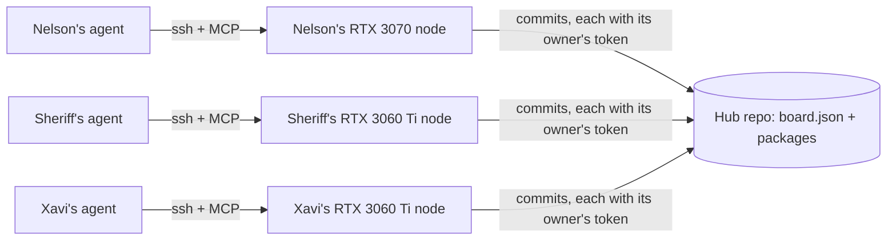

# IRIS skill nodes

Each person's GPU machine trains and checks IRIS skill adapters (RFC-014) for a board everyone
shares. An AI agent — Claude or any other client that speaks MCP — does the work through the
node's tools. It reaches the machine through SSH, so the machine opens no port of its own.



## How work is shared

1. **Choose.** `skill_board` lists the work, most needed first:
   - candidates someone else trained that are waiting for a check;
   - skills people asked for (`skill_want`);
   - skills with no package in use yet;
   - retrains of skills that already have one.

   The agent picks work its node has the data for. The agent decides what to train, and the
   board keeps two nodes from doing the same thing.
2. **Claim.** `skill_claim` holds a skill for up to 12 hours. No other node can take it
   meanwhile.
3. **Train.** `skill_train` runs the IRIS Foundry trainer in the background:
   - the base stays frozen and a rank-8 adapter trains;
   - the node's own sealed windows measure it before and after.

   Follow it with `job_status`. The trainer is detached from the SSH session, so the agent may
   disconnect.
4. **Publish.** `skill_publish` uploads the package as a candidate, but only if the node's own
   check promoted it.
5. **Check.** Another person's node runs `skill_check` on the candidate against its own
   sealed windows. `skill_record_check` then writes the verdict:
   - verified: the candidate becomes the package in use;
   - not verified: it is marked rejected, with the reason.

   Nobody can check their own work.
6. **Install.** `skill_install` downloads the package in use for a skill to where IRIS serving
   reads it.

**Credits.** Every change is a commit made with the token of the node's person, so the Hub's
history shows who trained and who checked what. The board also counts, per person, packages
promoted, checks made and packages rejected.

## Setting up a node (Windows)

1. **SSH.** Settings → System → Optional features → **OpenSSH Server**, then start the
   `sshd` service. Add your agent machine's public key to
   `C:\Users\<you>\.ssh\authorized_keys`. For an administrator account the file is
   `C:\ProgramData\ssh\administrators_authorized_keys` instead.
2. **IRIS Foundry.** Clone `archie-iris` to `C:\iris\archie-iris` and create its Python
   environment at `C:\iris\venv`, with the PyTorch build for CUDA 12.
3. **The base.** Put the IRIS Beta 2 weights at `C:\iris\base\iris-beta2.pt`. Every node
   must use the same file, because a package only loads on the base it was trained on.
4. **The node.**
   ```bash
   archie-skill-node init --config C:\iris\node.toml --contributor nelson --gpu "RTX 3070 8GB"
   ```
   Check the paths in the file it writes.
5. **The token.** Create a Hugging Face token with write access to the shared repository and
   store it for your account only:
   ```bash
   setx HF_TOKEN "hf_..."
   ```
   Never put it in the config file or in a chat.
6. **Data.**
   - CS:GO: `tools/vast/fetch_csgo.sh` into `IRIS_CSGO_DIR`.
   - A recorded skill: its windows in `C:\iris\node\data\<name>\*.npz`. With `IRIS_SKILL_SEAL`
     set, the node seals some of them.
7. **Connect your agent.** Run this on the node to print the lines to paste into your agent:
   ```bash
   archie-skill-node client --host you@your-pc --config C:\iris\node.toml --name iris-you
   ```

**The shared repository.** Nelson creates one private Hub model repository (for example
`PentaVM/iris-skills`) and gives write access to everyone who runs a node. The first
package published writes the board.

## Limits, as of 2026-09-30

- **Not built yet.** This PC's disks are full and the Vast host is down, so the binary has not
  been compiled. Its first build and test run go on the RTX 3070.
- **Memory is not measured.** The 8 GB peak of a skill job on the Beta 2 base has not been
  measured. If it does not fit, the batch goes down first.
- **Windows sessions.** OpenSSH can end a session's processes when it closes. The node first
  starts the trainer outside the session's job object. If Windows refuses that, the trainer
  runs inside the session, and disconnecting may stop it. The first run on Windows tells which
  applies.
- **Package size.** Packages are committed inline, up to 8 MB. A rank-8 adapter is a few MB.
- **GUI steps.** The trainer takes window sources (CS:GO, recorded windows). Pointing steps
  from GUI datasets are not a skill source yet.

## One RTX 3090, or three 8 GB cards?

For adapters, the three cards are better. Each adapter is its own job, so three nodes train
three skills at once. Together their compute (~16 + 16 + 20 FP32 TFLOPS) exceeds one 3090
(~36).

Training the IRIS base itself is different. It needs one large GPU, because its memory does
not split across home machines.
